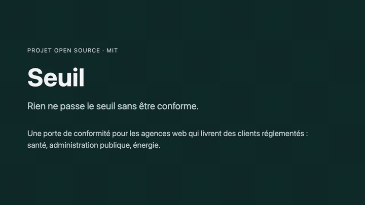

# Seuil

> Rien ne passe le seuil sans être conforme.

[English version](README.md) · [Vitrine](https://phlearning.github.io/seuil/) · [Licence : MIT](LICENSE)

Seuil est une porte de conformité pour les agences web qui livrent des produits à des clients réglementés (santé, administration publique, énergie). Il s'exécute dans la pull request, des design tokens jusqu'aux pages déployées, et bloque le merge tant que l'accessibilité (WCAG 2.2 AA, eCH-0059), la protection des données (nLPD) ou la sécurité échouent. Il rédige ensuite le rapport d'audit que l'agence remet à son client.

## Vidéo

[](docs/media/seuil-presentation.mp4)

[Voir la vidéo complète (MP4, 90 s, sous-titrée en français)](docs/media/seuil-presentation.mp4). Elle est filmée sur le vrai outil : `node docs/video/record.mjs` la reconstruit.

<details>
<summary>Version texte de la vidéo</summary>

1. **Seuil** : une porte de conformité pour les agences web qui travaillent pour des clients réglementés.
2. **Le problème** : les clients publics doivent prouver l'accessibilité (WCAG 2.2 AA, eCH-0059) ; une police ou un traceur ajouté en passant envoie l'IP des visiteurs à l'étranger (nLPD) ; ces défauts se voient trop tard, souvent chez le client.
3. **La vitrine** : trois clients fictifs, une même fonctionnalité livrée deux fois.
4. **Une pull request rouge est bloquée** : `seuil check` trouve Google Analytics chargé avant tout consentement, une CSP retirée et un lodash vulnérable, liste les flux vers Google aux États-Unis, et sort avec le code 1.
5. **Le commentaire de pull request** : un commentaire par projet, mis à jour à chaque push.
6. **L'audit guidé** : les 55 critères WCAG 2.2 A et AA, chacun avec un verdict et un constat.
7. **Le rapport client** : imprimable, avec les verdicts WCAG 2.2 AA et eCH-0059, le registre des flux et les limites assumées.
8. **Mettre en place** : GitHub Action, template GitLab CI, `seuil.config.json`, ou Docker partout.
9. **Utiliser** : `seuil check`, `seuil review`, `seuil report`.
</details>

## Ce que Seuil contrôle

| Domaine | Contrôles | Référentiel |
|---|---|---|
| Design tokens | Contraste texte et fond par thème, avant même le code, avec la couleur conforme la plus proche | WCAG 1.4.3, 1.4.11 |
| Accessibilité | axe-core, vrai parcours au clavier (focus visible, pièges, éléments atteignables), redistribution à 320 px, zoom à 200 %, espacement du texte, animations, taille des cibles, étiquettes, snapshots de l'arbre d'accessibilité | WCAG 2.2 AA, eCH-0059 v3.0 |
| Audit guidé | Les critères qu'aucune machine ne peut juger, vérifiés par une personne dans une interface locale ; un verdict devient caduc si sa page change | Les 55 critères WCAG 2.2 A et AA |
| Tiers | Chaque requête externe, la société et son pays, le pays du serveur, les traceurs et cookies posés avant tout choix, un registre des flux pour le DPO du client | nLPD art. 16 et 19, LTC art. 45c |
| Sécurité | Analyse de la CSP, HSTS, en-têtes de sécurité, dépendances vulnérables (OSV) | nLPD art. 8, OWASP |

Seuil fait un constat technique : ce n'est pas un avis juridique, et les contrôles automatiques ne déclarent jamais à eux seuls un critère WCAG conforme.

## Démarrage rapide

Nécessite Node 22 ou plus récent et pnpm 12.

```bash
git clone https://github.com/phlearning/seuil.git && cd seuil
pnpm install
pnpm build
pnpm geoip           # base pays DB-IP Lite, une fois par mois
pnpm demos:serve     # les trois clients fictifs sur les ports 4301 à 4303, à laisser tourner
```

Dans un second terminal :

```bash
cd demos/sante
node ../../packages/seuil/dist/cli.js check
node ../../packages/seuil/dist/cli.js review
node ../../packages/seuil/dist/cli.js report --client "Clinique des Aubépines" -o seuil-report/rapport.html
```

`check` écrit `seuil-results.json`, `review` ouvre l'audit guidé sur http://127.0.0.1:4310, `report` écrit le rapport client.

## Mettre en place dans un projet

### 1. Ajouter `seuil.config.json`

```json
{
  "targets": ["https://staging.client.ch/", "https://staging.client.ch/contact"],
  "tokens": {
    "path": "tokens",
    "themes": ["client"],
    "pairs": [["color.text.default", "color.bg.default"]]
  },
  "allowThirdParties": [],
  "failOn": "error"
}
```

| Clé | Rôle | Par défaut |
|---|---|---|
| `targets` | Pages, URL d'un Storybook (une cible par story) ou dossier buildé | `[]` |
| `tokens.path`, `tokens.themes`, `tokens.pairs` | Dossier des tokens DTCG, thèmes à vérifier, paires texte et fond (`["fg", "bg"]` ou `{ "fg", "bg", "kind": "text" \| "large-text" \| "ui" }`) | pas de contrôle des tokens |
| `audit.storybookGlobals` | Globals Storybook sous lesquels auditer chaque story, par exemple `"theme:client"` | `[]` |
| `audit.snapshots` | Dossier des snapshots de l'arbre d'accessibilité, versionnés | `.seuil/snapshots` |
| `firstParty` | Hôtes qui appartiennent au client, en plus de l'hôte de chaque page | `[]` |
| `allowThirdParties` | Tiers validés avec le DPO : noms d'hôte ou identifiants de fournisseur | `[]` |
| `lockfiles` | Lockfiles comparés à OSV | détectés à côté de la config |
| `failOn` | `error` ou `warning` | `error` |
| `offline` | `true` désactive la requête OSV | `false` |

### 2. L'exécuter en CI

GitHub Actions, avec un commentaire par projet sur la pull request et les rapports en artefacts :

```yaml
permissions:
  pull-requests: write
steps:
  - uses: actions/checkout@v4
  # ... construire et servir le site, ou déployer une review app ...
  - uses: phlearning/seuil/action@main
    with:
      client: Clinique des Aubépines
```

GitLab CI, y compris auto-hébergé. Ajoutez un project access token en variable `SEUIL_GITLAB_TOKEN` pour obtenir un commentaire de merge request :

```yaml
include:
  - remote: https://raw.githubusercontent.com/phlearning/seuil/main/gitlab/seuil.gitlab-ci.yml
```

Partout où Docker tourne (Chromium headless, les données et DB-IP Lite sont dans l'image) :

```bash
docker run --rm -v "$PWD:/work" ghcr.io/phlearning/seuil check
```

## L'utiliser

| Commande | Rôle |
|---|---|
| `seuil check` | Tout ce que décrit la config : tokens, chaque cible, dépendances. Écrit `seuil-results.json` |
| `seuil audit <url \| dossier>` | Audite une cible. `--rules a11y/axe,a11y/keyboard` pour restreindre, `--update-snapshots` pour accepter un changement voulu |
| `seuil tokens [dossier]` | Contraste des tokens seul |
| `seuil review` | Audit guidé sur http://127.0.0.1:4310, enregistré dans `seuil-review.json` (à versionner). `--export <dossier>` en écrit une copie en lecture seule |
| `seuil report` | `--format html` rapport client, `md` commentaire de pull request, `csv` registre des flux ; `--lang fr \| en` |

Codes de sortie : `0` conforme, `1` défauts au niveau de `failOn` ou au-dessus, `2` un contrôle n'a pas pu s'exécuter (résultat incomplet, jamais présenté comme vert).

Le déroulé habituel : la pull request lance `seuil check` et bloque sur les erreurs ; avant la livraison, une personne lance `seuil review` pour les critères qui demandent un humain, puis `seuil report` produit le document pour le client.

## L'utiliser avec Claude et d'autres IA

`seuil mcp` lance Seuil comme serveur [MCP](https://modelcontextprotocol.io) : une IA peut lancer la porte, regarder l'élément fautif et corriger le code jusqu'à ce que la porte soit verte.

| Outil | Ce que l'IA obtient |
|---|---|
| `audit`, `check` | Les défauts regroupés par élément : règle, sélecteur CSS, extrait HTML, référence WCAG ou nLPD, correction suggérée |
| `findings` | La même chose, filtrée depuis `seuil-results.json` sans relancer les contrôles |
| `screenshot` | Une image de la page avec l'élément encadré, focalisé si besoin, à 320 px ou en 640x400 pour voir la redistribution et le zoom |
| `report` | Le commentaire de PR, le rapport client ou le registre des flux |
| `review_status` | Les critères WCAG qu'une personne doit encore vérifier, avec leur checklist |

**Dans ce dépôt**, Claude Code charge `.mcp.json` et le skill `seuil` (`.claude/skills/seuil/`), qui lui apprend la boucle : lancer la porte, regarder, corriger la cause, reconstruire, relancer. Demandez par exemple « fais passer la porte de la démo admin au vert ».

**Dans un autre projet :**

```bash
# depuis un clone de ce dépôt
claude mcp add seuil -- node /chemin/vers/seuil/packages/seuil/dist/cli.js mcp
# ou avec Docker (Linux ; sur macOS, faites pointer les cibles vers host.docker.internal)
claude mcp add seuil -- docker run -i --rm --network host -v "$PWD:/work" -w /work ghcr.io/phlearning/seuil mcp
```

L'IA corrige ce que les contrôles trouvent ; les verdicts de l'audit guidé restent à une personne, et `review_status` est volontairement en lecture seule.

## Pull requests de démonstration

Chaque client fictif a une fonctionnalité conforme mergée dans `main` (verte), puis une pull request ouverte qui la dégrade, comme cela arrive souvent dans les vrais projets (rouge). Seuil bloque les rouges.

| Client | Fonctionnalité verte, mergée | Pull request rouge, bloquée pour |
|---|---|---|
| Clinique des Aubépines | [Questionnaire préalable](https://github.com/phlearning/seuil/commit/3281eb2) | [`demo/sante-questionnaire-compact`](https://github.com/phlearning/seuil/pulls?q=is%3Apr+head%3Ademo%2Fsante-questionnaire-compact) : piège au clavier, champs identifiés seulement par leur placeholder |
| Commune de Valfleurie | [Nouvelle charte](https://github.com/phlearning/seuil/commit/0126407) | [`demo/admin-google-fonts`](https://github.com/phlearning/seuil/pulls?q=is%3Apr+head%3Ademo%2Fadmin-google-fonts) : Google Fonts (IP des visiteurs envoyée aux États-Unis), token de contraste insuffisant, formulaire de largeur fixe |
| Cascade Énergie | [Mesure d'audience](https://github.com/phlearning/seuil/commit/41fdb31) | [`demo/energie-google-analytics`](https://github.com/phlearning/seuil/pulls?q=is%3Apr+head%3Ademo%2Fenergie-google-analytics) : Google Analytics avant consentement, CSP retirée, lodash vulnérable |

La [vitrine](https://phlearning.github.io/seuil/) présente les démos jouables, leurs rapports clients, les rapports des versions rouges et les audits guidés. Les audits guidés sont des audits de démonstration, à valider par une personne qualifiée.

## Organisation du dépôt

| Chemin | Contenu |
|---|---|
| `packages/seuil` | Le CLI : règles, serveur de revue, rapports |
| `packages/tokens`, `packages/ui` | Tokens DTCG à trois thèmes, composants React et Storybook |
| `packages/review` | Interface de l'audit guidé |
| `data/` | Critères WCAG 2.2 (français et anglais), fournisseurs tiers |
| `demos/` | Les trois clients fictifs, chacun avec sa config, ses snapshots et son audit guidé |
| `action/`, `gitlab/`, `Dockerfile` | Intégrations CI et image |
| `site/`, `docs/video/` | Vitrine et vidéo, reconstruites par `pnpm showcase` et `node docs/video/record.mjs` |

```bash
pnpm typecheck && pnpm test   # les règles navigateur tournent dans un vrai Chromium
```

## Souveraineté des données

L'outil n'envoie aucune donnée, hormis la requête optionnelle de vulnérabilités à OSV (noms et versions des paquets uniquement, désactivable avec `"offline": true`). Il peut tourner entièrement sur l'infrastructure du client, y compris sur un GitLab auto-hébergé.

## Licence

MIT, voir [LICENSE](LICENSE). Données de localisation des serveurs : [IP Geolocation by DB-IP](https://db-ip.com), licence CC BY 4.0. Les clients, marques et audits des démos sont fictifs.
