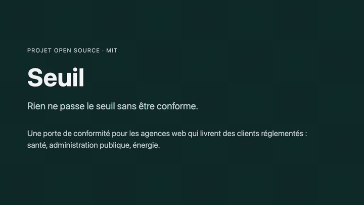

# Seuil

> Nothing crosses the threshold unless it complies.

[Version française](README.fr.md) · [Showcase](https://phlearning.github.io/seuil/) · [License: MIT](LICENSE)

Seuil is a compliance gate for web agencies that ship products to regulated clients (health, public administration, energy). It runs in the pull request, from the design tokens to the deployed pages, and blocks the merge while accessibility (WCAG 2.2 AA, eCH-0059), data protection (Swiss nLPD) or security fail. It then writes the audit report the agency hands to its client.

## Video

[](docs/media/seuil-presentation.mp4)

[Watch the full video (MP4, 90 s, French captions)](docs/media/seuil-presentation.mp4). It is recorded from the real tool: `node docs/video/record.mjs` rebuilds it.

<details>
<summary>Text version of the video</summary>

1. **Seuil**: a compliance gate for web agencies working for regulated clients.
2. **The problem**: public clients must prove accessibility (WCAG 2.2 AA, eCH-0059); a font or tracker added in passing sends visitors' IP addresses abroad (nLPD); these defects are found too late, often by the client.
3. **The showcase**: three fictional clients, the same feature delivered twice.
4. **A red pull request is blocked**: `seuil check` finds Google Analytics loaded before consent, a removed CSP and a vulnerable lodash, lists the data flows to Google in the US, and exits with code 1.
5. **The pull request comment**: one comment per project, updated on every push.
6. **The guided review**: the 55 WCAG 2.2 A and AA criteria, each with a verdict and a finding.
7. **The client report**: printable, with WCAG 2.2 AA and eCH-0059 verdicts, the data-flow register and the stated limits.
8. **Setting up**: GitHub Action, GitLab CI template, `seuil.config.json`, or Docker anywhere.
9. **Using it**: `seuil check`, `seuil review`, `seuil report`.
</details>

## What it checks

| Area | Checks | Reference |
|---|---|---|
| Design tokens | Text and background contrast per theme, before any code exists, with the nearest passing color | WCAG 1.4.3, 1.4.11 |
| Accessibility | axe-core, a real keyboard walk (focus visible, traps, reachability), reflow at 320 px, 200% zoom, text spacing, motion, target size, labels, accessibility tree snapshots | WCAG 2.2 AA, eCH-0059 v3.0 |
| Guided review | The criteria no machine can judge, checked by a person in a local UI; a verdict goes stale when its page changes | All 55 WCAG 2.2 A/AA criteria |
| Third parties | Every external request, the provider's company and country, the server country, trackers and cookies set before any choice, a data-flow register for the client's DPO | nLPD art. 16 and 19, TCA art. 45c |
| Security | CSP analysis, HSTS, security headers, vulnerable dependencies (OSV) | nLPD art. 8, OWASP |

Seuil reports technical facts: it is not legal advice, and automated checks never declare a WCAG criterion compliant on their own.

## Quick start

Requires Node 22 or later and pnpm 12.

```bash
git clone https://github.com/phlearning/seuil.git && cd seuil
pnpm install
pnpm build
pnpm geoip           # DB-IP Lite country database, once a month
pnpm demos:serve     # the three fictional clients on ports 4301 to 4303, keep it running
```

In a second terminal:

```bash
cd demos/sante
node ../../packages/seuil/dist/cli.js check
node ../../packages/seuil/dist/cli.js review
node ../../packages/seuil/dist/cli.js report --client "Clinique des Aubépines" -o seuil-report/rapport.html
```

`check` writes `seuil-results.json`, `review` opens the guided review on http://127.0.0.1:4310, `report` writes the client report.

## Set it up in a project

### 1. Add `seuil.config.json`

```json
{
  "targets": ["https://staging.client.ch/", "https://staging.client.ch/contact"],
  "tokens": {
    "path": "tokens",
    "themes": ["client"],
    "pairs": [["color.text.default", "color.bg.default"]]
  },
  "allowThirdParties": [],
  "failOn": "error"
}
```

| Key | Meaning | Default |
|---|---|---|
| `targets` | Pages, a Storybook URL (one target per story) or a built folder | `[]` |
| `tokens.path`, `tokens.themes`, `tokens.pairs` | DTCG tokens folder, themes to check, text/background pairs (`["fg", "bg"]` or `{ "fg", "bg", "kind": "text" \| "large-text" \| "ui" }`) | no token check |
| `audit.storybookGlobals` | Storybook globals to audit each story under, such as `"theme:client"` | `[]` |
| `audit.snapshots` | Folder of committed accessibility tree snapshots | `.seuil/snapshots` |
| `firstParty` | Hosts that belong to the client, besides each page's own host | `[]` |
| `allowThirdParties` | Third parties reviewed with the DPO: host names or provider ids | `[]` |
| `lockfiles` | Lockfiles checked against OSV | detected next to the config |
| `failOn` | `error` or `warning` | `error` |
| `offline` | `true` skips the OSV lookup | `false` |

### 2. Run it in CI

GitHub Actions, with one comment per project on the pull request and the reports as artifacts:

```yaml
permissions:
  pull-requests: write
steps:
  - uses: actions/checkout@v4
  # ... build and serve the site, or deploy a review app ...
  - uses: phlearning/seuil/action@main
    with:
      client: Clinique des Aubépines
```

GitLab CI, including self-hosted GitLab. Add a project access token as `SEUIL_GITLAB_TOKEN` to get a merge request comment:

```yaml
include:
  - remote: https://raw.githubusercontent.com/phlearning/seuil/main/gitlab/seuil.gitlab-ci.yml
```

Anywhere with Docker (headless Chromium, the data and DB-IP Lite are in the image):

```bash
docker run --rm -v "$PWD:/work" ghcr.io/phlearning/seuil check
```

## Use it

| Command | What it does |
|---|---|
| `seuil check` | Everything in the config: tokens, every target, dependencies. Writes `seuil-results.json` |
| `seuil audit <url \| folder>` | Audits one target. `--rules a11y/axe,a11y/keyboard` to narrow it, `--update-snapshots` to accept an intended change |
| `seuil tokens [dir]` | Token contrast only |
| `seuil review` | Guided review on http://127.0.0.1:4310, saved in `seuil-review.json` (commit it). `--export <dir>` writes a read-only copy |
| `seuil report` | `--format html` client report, `md` pull request comment, `csv` data-flow register; `--lang fr \| en` |

Exit codes: `0` compliant, `1` findings at or above `failOn`, `2` a check could not run (the results are incomplete, never reported as green).

The usual flow: the pull request runs `seuil check` and blocks on errors; before delivery, a person runs `seuil review` for the criteria that need a human, then `seuil report` produces the document for the client.

## Demo pull requests

Each fictional client gets the same feature twice: a red pull request that Seuil blocks, left open, and a green version merged into `main`.

| Client | Feature | Red pull request, blocked for | Green version |
|---|---|---|---|
| Clinique des Aubépines | Pre-visit questionnaire | [`demo/sante-questionnaire-rouge`](https://github.com/phlearning/seuil/pulls?q=is%3Apr+head%3Ademo%2Fsante-questionnaire-rouge): keyboard trap, fields labelled only by placeholders | [ebdac62](https://github.com/phlearning/seuil/commit/ebdac62) |
| Commune de Valfleurie | New brand | [`demo/admin-charte-rouge`](https://github.com/phlearning/seuil/pulls?q=is%3Apr+head%3Ademo%2Fadmin-charte-rouge): Google Fonts (IP addresses sent to the US), low-contrast token, fixed-width form | [7f5fddb](https://github.com/phlearning/seuil/commit/7f5fddb) |
| Cascade Énergie | Audience measurement | [`demo/energie-audience-rouge`](https://github.com/phlearning/seuil/pulls?q=is%3Apr+head%3Ademo%2Fenergie-audience-rouge): Google Analytics before consent, CSP removed, vulnerable lodash | [b96435e](https://github.com/phlearning/seuil/commit/b96435e) |

The [showcase](https://phlearning.github.io/seuil/) has the live demos, their client reports, the reports of the red versions and the guided reviews. The guided reviews are demonstration audits, to be validated by a qualified person.

## Repository

| Path | Content |
|---|---|
| `packages/seuil` | The CLI: rules, review server, reports |
| `packages/tokens`, `packages/ui` | DTCG tokens with three themes, React components and Storybook |
| `packages/review` | Guided review UI |
| `data/` | WCAG 2.2 criteria (French and English), third-party providers |
| `demos/` | The three fictional clients, each with its config, snapshots and guided review |
| `action/`, `gitlab/`, `Dockerfile` | CI integrations and image |
| `site/`, `docs/video/` | Showcase and video, rebuilt by `pnpm showcase` and `node docs/video/record.mjs` |

```bash
pnpm typecheck && pnpm test   # 150 tests, browser rules run in real Chromium
```

## Data sovereignty

The tool sends no data anywhere, except the optional OSV vulnerability lookup (package names and versions only, disabled with `"offline": true`). It can run entirely on the client's own infrastructure, including self-hosted GitLab.

## License

MIT, see [LICENSE](LICENSE). Server location data: [IP Geolocation by DB-IP](https://db-ip.com), CC BY 4.0. Clients, brands and audits in the demos are fictional.
